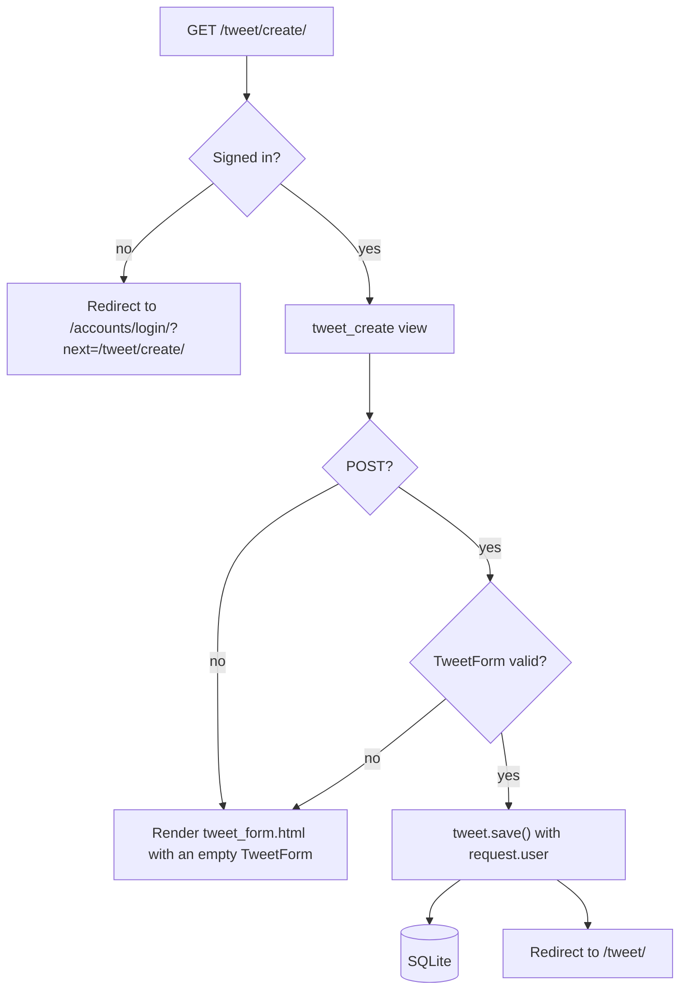

# djangoChickbum

Short-form posting app built on Django: register, sign in, post a text tweet with an optional
photo, then edit or delete your own posts. Authentication and admin are stock Django — the custom
code is the `tweet` app.

## Run it locally

Needs Python 3.12+ (Django 6.1 won't run on older versions).

```bash
python -m venv .venv
source .venv/bin/activate
pip install -r requirements.txt

cd djangoChickbum
python manage.py migrate
python manage.py runserver
```

Then open <http://127.0.0.1:8000/tweet/>. There's no page at `/` — the feed lives under `/tweet/`
and the URLconf doesn't register a root route. For admin access, run
`python manage.py createsuperuser` and go to `/admin/`.

## Routes

| URL | View | Notes |
| --- | --- | --- |
| `/tweet/` | `tweet_list` | All tweets, newest first. Edit/Delete buttons only appear on your own. |
| `/tweet/create/` | `tweet_create` | `@login_required`; saves the tweet with `request.user`. |
| `/tweet/<id>/edit/` | `tweet_edit` | `get_object_or_404(Tweet, pk=..., user=request.user)` — someone else's tweet is a 404, not a 403. |
| `/tweet/<id>/delete/` | `tweet_delete` | GET shows the confirm page, POST deletes. |
| `/tweet/register/` | `register` | Custom `UserCreationForm`; logs the new user in immediately. |
| `/accounts/login/` | Django `LoginView` | `LOGIN_REDIRECT_URL` is `/tweet/`. |
| `/accounts/logout/` | Django `LogoutView` | POST-only in modern Django, which is why the navbar logs out with a form. |
| `/health` | `health` | Returns `{"status": "ok"}`, for uptime probes. |
| `/admin/` | Django admin | `Tweet` is registered there. |

`django.contrib.auth.urls` also wires up the password-reset views, but only `login.html` and
`logged_out.html` exist under `templates/registration/`, so those extra pages would fail to
render as-is.

## Creating a tweet



`tweet_edit` is the same shape, except the form starts from an existing instance and the lookup
already filters by owner. Every page extends `templates/layout.html`, which holds the Bootstrap
navbar, the Login/Register buttons, and the POST logout form.

## Layout

```
djangoChickbum/
├── manage.py
├── djangoChickbum/          settings, root URLconf, wsgi/asgi, health view
├── templates/               layout.html + registration/ (login, logged_out, register)
├── static/                  served by staticfiles; empty apart from .gitkeep
├── media/                   uploaded photos (git-ignored)
└── tweet/
    ├── models.py            Tweet(user, text, photo, created_at, updated_at)
    ├── forms.py             TweetForm, UserRegistrationForm
    ├── views.py             list / create / edit / delete / register
    ├── urls.py
    └── templates/           index.html, tweet_list.html, tweet_form.html, tweet_confirm_delete.html
```

`photo` is nullable, so the list template renders the `` only when a file exists.

## Deploying for free

Two realistic free options. Both need at least two changes first: set `ALLOWED_HOSTS` to your
domain, and read `SECRET_KEY` from an environment variable instead of the hardcoded dev key.
Also turn `DEBUG` off. SQLite plus `media/` on local disk is fine for a demo, not for anything
that matters.

**PythonAnywhere — least effort, data survives.** The free Beginner account gives one web app at
`yourname.pythonanywhere.com`, 512 MB of persistent disk, and no custom domain. Because the disk
persists, `db.sqlite3` and uploaded photos stay put. Rough flow: clone the repo in a Bash console,
make a virtualenv with Python 3.13+, `pip install -r requirements.txt`, add a Manual-config web
app, point the WSGI file at this project and set
`DJANGO_SETTINGS_MODULE=djangoChickbum.settings`, add your host to `ALLOWED_HOSTS`, run
`migrate`, map `/static/` and `/media/` in the web app's static-files section, reload. The free
tier blocks outbound internet except for a whitelist; this app doesn't call anything external.

**Render — git push to deploy, database resets.** The free web service has 512 MB RAM and spins
down after 15 minutes without traffic (about a minute to wake). Its filesystem is ephemeral, so
SQLite and `media/` are wiped on every deploy, restart, or spin-down, and the free Postgres
option expires 30 days after creation. It also needs two packages this repo doesn't have yet:
`gunicorn` to serve and `whitenoise` for static files. More setup, nicer workflow.

For a demo you don't want to babysit, PythonAnywhere. For push-to-deploy and a custom domain,
Render — accepting that the data resets.
